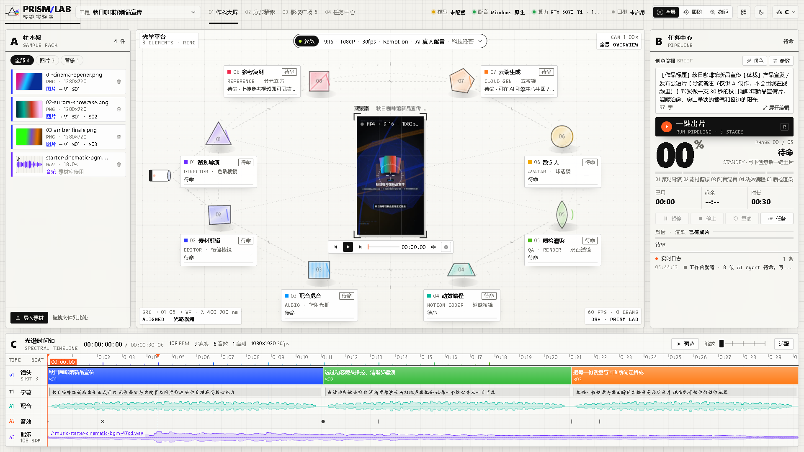
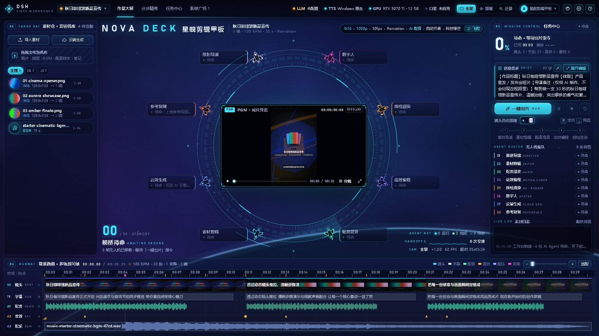
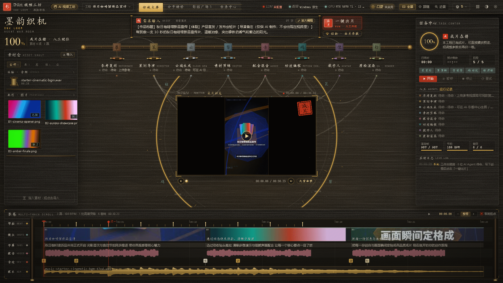
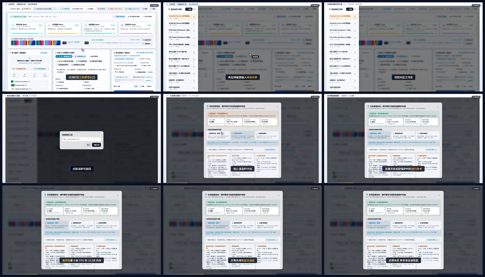
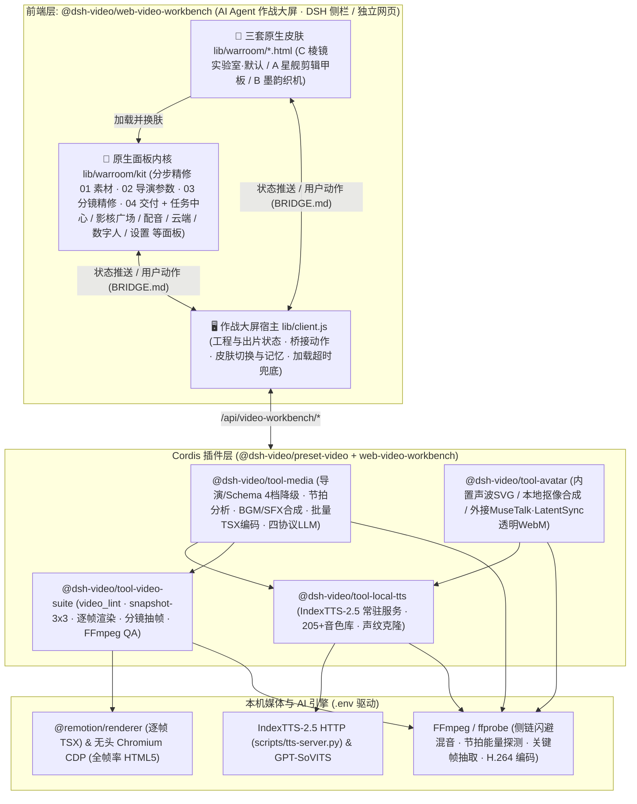
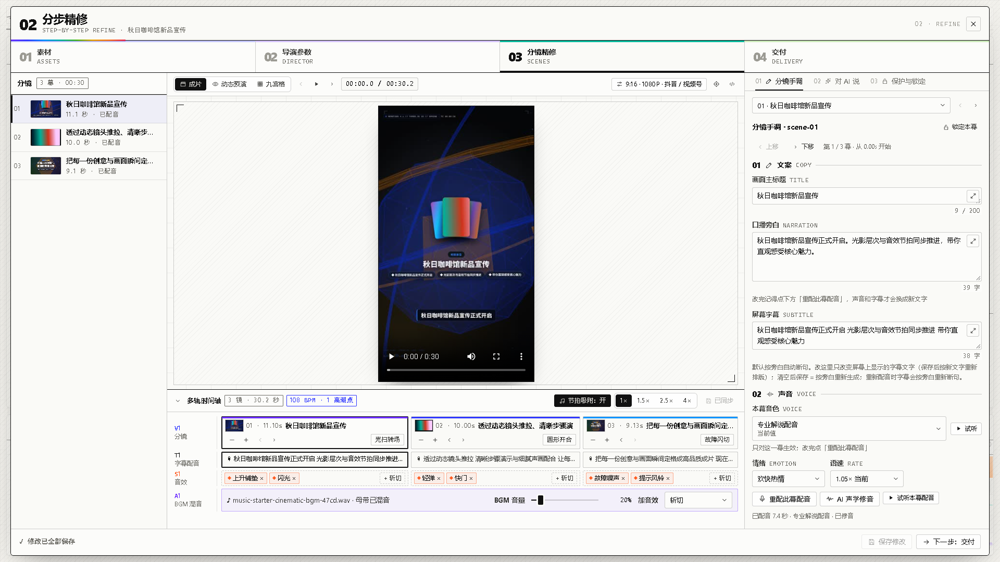

# 🎬 DSH Video Workbench (`dsh-video-workbench` · v0.6.0)

> **全智能体通用双引擎 AI 视频全链路工作台（不限 DSH！支持 DeepSeek Harness · Claude Code · OpenAI Codex CLI · WorkBuddy · Cursor · Windsurf · Cline · Antigravity · 无黑窗静默后台独立网页）**  
> **Universal Multi-Agent Dual-Engine AI Video Studio — CinePulse Hub (影核广场) `MOTION.md` Template Plaza, Cross-Genre Adaptive Beat-Sync & 48kHz SFX Mastering, Reference vs Remake Split/Curtain Sync Compare Player, 4-Track Visual Timeline, Optional BYOK Cloud Image/Video/Music (`Seedream` / `Seedance` / `Kling` / `Flux` / `Suno` / `MiniMax` + Open Custom HTTP Protocol), & Optional 1-Click Local TTS Installer**

[](./LICENSE)
[](#-四全智能体安装与接入指南不限-dshuniversal-multi-agent-setup)
[](#)
[](#-联系作者与原创版权声明-author--copyright)
[](#-联系作者与原创版权声明-author--copyright)
[](#-联系作者与原创版权声明-author--copyright)
[](#-联系作者与原创版权声明-author--copyright)

> 🛡️ **原创开源署名声明**：本项目由 **Merziller** 原创开源并依据 [MIT 协议](./LICENSE) 免费提供使用。任何二次分发、修改、打包、转载或商业/演示使用，**必须完整保留原作者署名与联系方式（作者：`Merziller` ｜ QQ：`1411574209` ｜ 微信：`Merziller` ｜ Gmail：`k26789228@gmail.com` ｜ 官方仓库：`https://github.com/Merziller/dsh-video-workbench`）**，严禁抹除作者信息冒充原创。详见 [`NOTICE`](./NOTICE)。

---

## 🆕 `v0.6.0` 更新：全新「AI Agent 作战大屏」界面（三套皮肤自由切换）



> - **🖥️ 作战大屏就是工作台**：旧版「经典」界面已整体退役，打开插件就直接进入 AI Agent 作战大屏。默认皮肤是 **「C · 棱镜实验室」**，还可以随时切换成 **「A · 星舰剪辑甲板」** 或 **「B · 墨韵织机」**（点大屏右上角的皮肤按钮）；切换后工程、素材和参数都不变，下次打开会记住你的选择。
> - **🧩 所有面板原生重做**：分步精修、任务中心、影核广场、配音中心、云端媒体中心、数字人、算力体检、设置 · 模型与密钥、发布包导出、品牌套件、版本历史等全部面板和弹窗，都按当前皮肤的风格原生绘制，并由同一套面板内核驱动——换皮肤不换操作。
> - **✍️ 大号创意编辑器**：点一下大屏上的创意需求框，就会弹出大号编辑器「创意需求 · 导演指令」：灵感模板、字数统计、「AI 一键润色」、「保存需求」和「保存并一键出片」一步到位；在大屏里改过的需求、标题和大纲会自动保存，重新打开工程也不会丢。
> - **🎬 全新安装也能一键出片**：电脑上没有单独配置 FFmpeg、只用插件自带的 FFmpeg 时，一键出片的最终混音不再报错或卡住，可以顺利导出能播放的 MP4。
> - **☁️ 云端生成恢复可用**：修复了 v0.5.3 中云端生图 / 生视频 / 音乐任务无法启动的问题；生成结果先进入「生成结果预览区」验收，丢弃后列表立即刷新。
> - **🎙️ 配音、录制与参考复刻更可靠**：音色库里同一段音频不再重复显示（旧的音色编号仍能选中原音色），导入后自动清理上传暂存文件；提词器 / 浏览器录下的视频入库不再损坏，时长准确；参考复刻总是使用你最新上传的那段参考视频。
> - **📝 字幕与审片修复**：重配单幕配音后字幕仍沿用旧断句、全局字幕轨与配音不同步、「清空字幕」误删全部、Remotion「720P 快速审片」画面不缩放等问题均已修复。
> - **🔤 细节打磨**：输入框的字数统计挪到框下方，不再遮挡文字；「试听」在播放过程中保持「停止」状态；用中文输入法打字或按住鼠标时，面板不会被后台刷新打断；弹出菜单不会跑出屏幕；工程标题不会再被意外改成「DSH Video Workbench」；旧版本留下的「undefined」需求文字会被自动清理；切换工程时不再误报「成片预览加载失败」。
> - **🧠 大模型默认「跟随当前智能体」**：在 DeepSeek Harness 里用 DSH 当前通道；在 Claude Code、Codex、opencode、OpenClaw、Hermes、pi、WorkBuddy、Antigravity 等智能体里，自动使用该智能体运行环境里的模型 API Key（`ANTHROPIC_API_KEY` / `OPENAI_API_KEY` 等），设置页会显示当前智能体和实际使用的模型；「指定 DSH 通道」与「自定义」照样可选。智能体的账号登录 / 订阅不会被插件借用。
> - **🎨 风格不再限死 6 种：「AI 自由匹配」+「我的风格预设」**：新工程默认让 AI 按你的主题挑风格——6 个预设里有合适的就直接用，都不合适就为这条片子设计一套新风格（配色、字体气质、运镜和配乐基调）；觉得好看可以「保存为我的预设」，下次在出片参数或「02 导演参数 → 视觉风格」里直接选（可改名、删除，最多 60 个）。本地极速草稿模式也会自动选一个合适的预设。
> - **📐 新增 3:4 画幅（小红书）**：所有选画幅的地方都有「3:4」（1080P 下为 1080×1440），「4:3」也修好了（以前选 4:3 实际会变成 AI 智能判断）。
> - **🧰 Vibecoding 工具由 AI 按需调用**：「02 导演参数」里原来的「3D / SVG / HUD 视效」改为「视效偏好」，默认「AI 按需自由创作」：8 个 Vibecoding 工具由 AI 按每一镜的需要自动挑选，工具满足不了的效果直接写代码实现；也可以偏好 3D 科技感或纯 2D。大模型编码的工程在「03 分镜精修」里，「视觉布局」默认是「AI 定制代码」，可以改用内置版式、随时切回。
> - **🖼️ 发布包封面可选可生成**：「发布包导出 → 封面」：默认自动从成片里挑最好的一帧（避开黑屏、转场和模糊画面），也可以在播放器里选定任意画面，或让 AI 按视频内容重新生成（提示词可改，比例 3:4 / 9:16 / 16:9 / 1:1 / 4:3），还能给封面加标题。
> - **🔍 免费素材库 Key 直接在页面里填**：Pexels / Pixabay 的 Key 在「版本历史与工程安全 → 免费素材」或「设置 → 云端生成」里填写、测试、保存，马上就能检索，不用再改配置文件。
> - **📺 成片全屏观看**：三套皮肤都能把成片铺满整个窗口播放（棱镜「全屏」/ 星舰 ⤢ / 墨韵 ⤢，或按 `V`），不会被两侧面板挡住；观看时按 `F` 进入真正的全屏，`Esc` 退出。
> - **🌐 影核广场开放投稿**：在影核广场「投稿到影核广场」里把自己的作品打成投稿包（自动检查，不含本机路径、密钥和个人信息），通过 GitHub 投稿表单或邮件发给作者，审核收录后大家点「刷新在线模板」就能用上，不用升级插件。详见 [docs/plaza-community.md](docs/plaza-community.md)。
> - **🔒 本地服务更安全、更稳**：工作台只接受自己页面的请求，其他网站无法再在后台调用本机接口；上传中途取消不会再让服务退出；自己写的旁白不会再被替换，在大屏里改需求也不会再改变画幅；恢复历史版本、删除音色、调色导出都不会再误删或覆盖文件。
> - **🧍 人物不再是「纸片人」：内置人物库 +「人物画风」任选**：动画里的人物、马匹、军阵可以用插件自带的人物库来画（剪影 / 剪纸 / 皮影 / 水墨 / 扁平插画 / 火柴人 6 种画风，37 种动作：走、跑、挥砍、骑马、鞠躬、举杯……关节连贯不错位）；也可以在「02 导演参数 → 视觉风格 → 人物画风」里选「自定义」，写上想要的样子（例如「Q版萌系，圆脸大眼」），AI 会自己设计角色，全片统一。默认「AI 按作品气质决定」：历史题材默认剪影，其它题材由 AI 自己定，不会把所有视频都做成同一种画风。
> - **👀 画面自检（AI 看图返工）**：AI 写完动画代码后，先把每个镜头渲染成截图，让大模型逐镜检查人物、构图、文字和亮度，有明显问题的镜头带着截图返工一次（「画面规格」里可关闭；需要能看图的模型，每批镜头多 1~2 次调用）。
> - **🧑‍🎨 演员表与角色库打通**：角色库里已有的人物沿用原来的形象，新出现的有名字的角色自动存进项目角色库，同一个角色在每个镜头里长得一样。
> - **🎧 声音更完整**：按画面自动铺环境音（江风、雨声、篝火、人群、城市、夜色……，跨镜头平滑衔接）；大模型配乐失败或渲染成静音时自动改用本地合成配乐，不会再出现整片没有背景音乐；成片音频峰值保护（编码后超过 −1 dBTP 自动微调音量重新封装，画面不动）；出片最后混音偶尔卡住会自动重跑；史诗题材的转场音效与镜头运动更跟拍。
> - **🎬 画面更稳、更安全**：全屏闪白统一按光敏安全预算安排（任意两次至少间隔 0.5 秒）；看不清的过暗镜头自动提亮（黑场白场不变）；质检新增「画面动势」，提示几乎不动的秒数。
> - **🧭 题材不再串味**：汉堡广告、游戏 MV 不会因为出现「王」「将」「战」等单字就被当成历史片，也不会被加上战鼓、兵器和刀光；产品、科普、MV 都按自己的内容来。
> - **🔁 大模型调用更耐用**：遇到限流（429）会按服务器提示等待后重试（最长 90 秒）；策划失败时改用你需求里的要点兜底，并在任务中心用黄色提示说明；质检没通过也会明确提示。
> - **🤖 智能体接口**：MCP 工具 `ai_create_video` / `run_agent_pipeline` 新增 `figureStyle` / `figureStyleNote` 参数（与界面上的「人物画风」一致），共 41 个 MCP 工具。
> - **✅ 全面验收**：三套皮肤 × 4 种窗口尺寸（1100×640 ~ 2560×1440）的主界面、全部面板与分步精修页面逐一检查：0 遮挡、0 报错。

| A · 星舰剪辑甲板 | B · 墨韵织机 |
| :---: | :---: |
|  |  |

> 👉 第一次使用？直接看下文 [「三、工作台使用指南」](#-三工作台使用指南ai-作战大屏--三套皮肤)，跟着 6 步就能出片。

---

## 🎥 官方完整实操教程视频 & `v0.5.0` 核心亮点

> - **仓库内教程视频**：[`docs/tutorial/dsh-video-workbench-tutorial.mp4`](./docs/tutorial/dsh-video-workbench-tutorial.mp4)（1080P · 3 分 17 秒 · 由本插件全链路自动生成）
>   - 📌 这段教程录制于 v0.5 旧版界面，按钮位置和现在不同；v0.6.0 的界面操作请以下文「三、工作台使用指南」为准。
> - **GitHub Release 高速直链下载**：
>   - 插件全能单包：[`dsh-video-workbench-0.6.0.tgz`](https://github.com/Merziller/dsh-video-workbench/releases/download/v0.6.0/dsh-video-workbench-0.6.0.tgz)
>   - 可选本地配音一键安装包（`Edge-TTS` / `IndexTTS-2.5` / `GPT-SoVITS`）：[`dsh-tts-installer-pack-0.6.0.zip`](https://github.com/Merziller/dsh-video-workbench/releases/download/v0.6.0/dsh-tts-installer-pack-0.6.0.zip)
>   - 1080P 教程成片：[`dsh-video-workbench-tutorial.mp4`](https://github.com/Merziller/dsh-video-workbench/releases/download/v0.6.0/dsh-video-workbench-tutorial.mp4)
> - **✨ `v0.5.0` 重磅新能力**：
>   1. **🔇 无黑窗后台静默守护**：Windows 双击 `start-workbench.cmd` / `start-workbench.vbs` 自动隐藏 CMD 黑窗并在后台静默常驻 `http://127.0.0.1:4399`，双击 `stop-workbench.cmd` 或 `node bin/dsh-video-cli.mjs stop` 优雅停止；
>   2. **🏛 影核广场 · CinePulse Hub**：内置 & 社区开放 `MOTION.md` 爆款模板广场（首批实产 5 大高频题材高质量模板：历史高燃卡点 / 科技旗舰发布会 / SaaS 实操教程 / 深度科普拆解 / 数据榜单洞察），支持一键复刻与发布分享；
>   3. **🥁 全品类自适应音画节拍与声学母带引擎**：不再局限于历史高燃！FFmpeg 节拍量化、48kHz 程序化音效调色盘（战斗/键鼠 UI/雷达科普/数据计数/轻喜剧弹簧/快门/人文风铃）、镜头律动强度与 EBU R128 响度混音全面按 10+ 体裁与 AI 导演 `audioProfile` 自动跟随匹配；
>   4. **⚖️ 参考视频 vs 复刻成品「左右分屏 / 拉帘同步对比播放器」** + **🎞️ 4 轨可视化时间轴微调台**（缩放、节拍吸附、调时长、换镜序、点切转场、48kHz 音效增删与 BGM 音量实时调节）；
>   5. **☁️ 可选 BYOK 云端生图 / 生视频 / 音乐与音频中心**：内置火山方舟 **即梦 Seedream / Seedance**、**可灵 Kling (JWT/Bearer)**、**Flux Pro / Fal**、**Suno Music**、**MiniMax Music-2.0 / Speech-02-HD / 海螺视频**、**ElevenLabs**，且**图片、视频、音频三大类全部开放自定义 HTTP JSON 协议**（支持同步与异步轮询）；
>   6. **📦 全新内置旗舰演示**：移除旧版 3 幕极简 Demo，内置 **22 幕双引擎官方宣传片** 与 **24 幕全功能实操教程** 两个完整工程；MCP 工具扩展至 **32 个**。
> - **作者联系（Bug 反馈 / 交流 / 建议）**：**QQ `1411574209`** ｜ **微信 `Merziller`** ｜ **Gmail `k26789228@gmail.com`**



---

## 📖 目录 / Table of Contents
- [🆕 v0.6.0 更新：全新「AI Agent 作战大屏」界面（三套皮肤）](#-v060-更新全新ai-agent-作战大屏界面三套皮肤自由切换)
- [🎥 官方完整实操教程视频 & v0.5.0 核心亮点](#-官方完整实操教程视频--v050-核心亮点)
- [一、核心特性 (Features)](#-一核心特性-features)
- [💻 电脑配置要求与低配电脑保护机制 (Hardware & Low-Spec Guard)](#-电脑配置要求与低配电脑保护机制-hardware--low-spec-guard)
- [二、系统架构图 (Architecture)](#️-二系统架构图-architecture)
- [三、工作台使用指南（AI 作战大屏 · 三套皮肤）](#-三工作台使用指南ai-作战大屏--三套皮肤)
- [四、全智能体安装与接入指南（Universal Multi-Agent Setup）](#-四全智能体安装与接入指南不限-dshuniversal-multi-agent-setup)
- [五、多引擎配音与声音克隆指南](#️-五多引擎配音indextts-25--gpt-sovits--自定义模型与声音克隆指南)
- [六、数字人叠加引擎说明 (`@dsh-video/tool-avatar`)](#-六数字人叠加引擎说明-dsh-videotool-avatar)
- [七、常见问题排查 (Troubleshooting)](#-七常见问题排查-troubleshooting)
- [📬 联系作者与原创版权声明 (Author & Copyright)](#-联系作者与原创版权声明-author--copyright)
- [八、English Documentation](#-八english-documentation)

---

## ✨ 一、核心特性 (Features)

1. **⚡ 8 位 AI Agent 作战大屏（三套原生皮肤）+ 分步精修 + 实时任务监控**：
   - **策划导演 → 素材剪辑 → 配音混音 → 动效编程 → 质检渲染** 五段主流水线全程可视化接力运行（**数字人、云端生成、参考复刻** 三位 Agent 按需出场），支持随时暂停、继续、停止子进程与断点重试，进度与「实时日志」同步显示。
   - 三套原生皮肤 **C · 棱镜实验室（默认）/ A · 星舰剪辑甲板 / B · 墨韵织机** 一键切换；所有面板、弹窗与分步精修页面都按当前皮肤原生绘制，换皮肤不换操作（详见 [「三、工作台使用指南」](#-三工作台使用指南ai-作战大屏--三套皮肤)）。
   - 接入 DeepSeek Harness 桌面端后，从左侧栏 **「AI 视频工坊」** 进入作战大屏；大屏左上角的 **「返回 DSH 对话」** 按钮可随时一键回到对话。
2. **🧠 通用四协议大模型接入 + ✨ AI 一键润色提示词**：
   - 默认 **「跟随当前智能体」(`auto`)**：在 DeepSeek Harness 里使用 DSH 当前选中的通道；在 Claude Code / Codex / opencode / OpenClaw / Hermes / pi / WorkBuddy / Antigravity / Cursor 等智能体里，自动使用该智能体运行环境中的模型 API Key（`ANTHROPIC_API_KEY`、`OPENAI_API_KEY`、`DEEPSEEK_API_KEY`、`GEMINI_API_KEY`、`OPENROUTER_API_KEY`，可配合 `*_BASE_URL`、`*_MODEL`），并优先选和该智能体匹配的服务商（如 Claude Code → Anthropic、Codex → OpenAI）。智能体的账号登录 / 订阅只能它自己使用，插件不会读取或借用。
   - 也可以 **「指定 DSH 通道」(`follow-dsh`)** 或 **「自定义」(`custom`)** 填写任意大模型；原生兼容 **OpenAI `/v1/chat/completions`**、**Anthropic `/v1/messages`**、**OpenAI `/v1/responses`** 与 **Google Gemini `/v1beta/models`** 四种接口协议。
   - **「✨ AI 一键润色」**（大号创意编辑器与「分步精修 → 02 导演参数」里都有这个按钮）：只需写一句大白话需求，AI 会结合已上传的图片/视频/BGM 与笔记内容输出结构化方案（自动隔离 **观众可见标题/内容要点 (`displayTitle`/`contentOutline`)** 与 **AI 专用导演备注 (`directorNotes`)**），杜绝制作指令泄露到视频台词或屏幕画面；同时支持**全品类无限自由体裁路由**（内置 11 种常见题材参考起点 + 任意自创 `genreLabel` 全链路透传 + `freeform-stage` 零固定版式限制，涵盖代码动画、亮色高倍率软件教程、历史水墨剧场、火柴人角色动画、真人口播、数字人、科普图解、数据故事、产品宣发乃至任意冷门/自创新体裁）与 **「恢复原句」**（润色后不满意可一键还原）。
   - **纯正中文字幕与发音引擎 (`subtitle-engine`)**：严格分离后台语音朗读文本 (`ttsText`) 与屏幕显示字幕 (`subtitleText`)，画面字幕自动保留自然阿拉伯数字（如 `206年`、`3000人`、`8 GB`）并剥离孤立引号，结合语义断句避免拆散词组或标点落单。
3. **🥁 音乐节拍踩点引擎 & 三种配音节奏模式 (`tts` / `tts-beat-sync` / `subtitle-mv`)**：
   - 上传个人 BGM 后自动调用 FFmpeg 波形能量包络探测 **真实 BPM、首拍相位与高潮突降点 (Drops)**。
   - 在大屏的出片参数面板（棱镜实验室「参数控制单」/ 星舰「飞控面板」/ 墨韵「经折 · 出片参数」，快捷键 `P`）的「旁白」一栏，或「分步精修 → 02 导演参数 → 背景音乐与配音节奏」里自由切换：
     - `🗣️ AI 真人配音`：逐幕调用本地 `IndexTTS-2.5` 合成人声旁白 + AI 声学修音 + 自动闪避混音；
     - `⚡ 配音 + 踩拍切镜`：保留真人旁白并让分镜切入贴合音乐节拍；
     - `🔥 纯音乐卡点 MV（免配音）`：跳过语音合成，按 `0.5` / `1` / `2` / `4` 拍自动对准重拍与高潮切镜，输出高燃纯动画 MV 与卡点音效。
   - **依题材自适应节奏（「AI 自动节奏」/「舒缓叙事」/「稳健解说」/「高燃踩点」，即 `auto` / `calm` / `balanced` / `dynamic`）**：不再一刀切套用历史片快闪节奏——品牌故事温情短片自动保持 `4~7s/镜` 从容留白，产品功能/教程保持 `3~5s/镜` 清晰解说，历史卡点 MV 才启用高速半拍闪烁切镜。
4. **🪐 Opus 5.5 级全开放自由编码 (`Freeform Three.js 3D` + 动态 `SVG` + `HUD` 遥测 + 节拍弹簧物理) + 内置保底预设**：
   - **真实交互式教程镜头、像素级坐标锚点与全链路无限制开放体裁 (`v0.3.4` ~ `v0.3.8`)**：支持高清晰亮色 UI 教程拍摄模式（`windowTheme: "light"`、`1.8x~2.4x` 局部特写推镜 `<FocusShot>`、`(0,0)` 尖端对齐光标与点击涟漪 `<InteractiveCursor>`、`clipPath` 平滑抽屉展开 `<UiDrawerSlide>` 及逐字打字 `<UiTypingOverlay>`，并自动挂载对齐 `click` / `whoosh` / `typing` 音效）；新增 **AI 大模型语义选音 (`castVoicesWithLlm`)**，自动索引本地高表现力精品音色并动态驱动 8 维情绪向量与语速曲线；**`v0.3.5`** 打通自创体裁标签 **`genreLabel` 全链路透传** 与 **`freeform-stage` 零固定版式策划**；**`v0.3.6`** 升级全四协议多模态视觉接口与像素级等比容器查询坐标系；**`v0.3.7`** 修复点击一键出片或切换工程后 AI 润色完整指令被清空/回显空白问题并新增母带 EBU R128 真峰值限幅；**`v0.3.8` ~ `v0.3.9`** 新增 **「⏱ 目标视频时长：AI 自由匹配 / 自定义时长（15~600 秒）」**（与 AI 一键润色、自然语言时长解析及防缩水自动补镜强联动），并将 **AI 润色超时上限升级至 10 分钟（`600s` + 异步后台任务轮询 + Node 原生 HTTP 长连接防 5 分钟 `headersTimeout` 断连）**；同时彻底打通 **上传 BGM 自动切换挂载、清晰踩拍混音（解决上传 BGM 无声/被压死）、自定义音效/文本笔记/声纹克隆/数字人底板全类型上传零遗漏采用**。
   - **真正无预设束缚的 AI 自由造景 (`<FreeformThreeStage />` + 动态 `<svg>`)**：在大模型编码模式下，AI 不再被固定模板或预设数量捆死！插件直接把原生 **`THREE.*`** 几何与相机接口（`FreeformThreeApi`：`addMesh` / `addLine3D` / `addParticle3D` / `addLabel3D` / `orbitPoint` / `arc3D`）、动态 **`<svg>`** 曲线工具（`buildSmoothSvgPath` / `describeSvgArc`）与 **HTML5 3D 透视投影** 开放给大模型主程，AI 可针对任意题材从零自由编写专属 3D 旋转地球、3D 芯片爆炸拆解、K线雷达图、思维导图或公式推演；内置 6 大 3D 舞台、5 种动态 SVG 拓扑 (`<SvgArchitectureDiagram />`) 与全息 HUD 代码面板 (`<HudDataDashboard />` + `<HudTelemetryOverlay />`) 既可作原子积木混搭，也作离线/容错保底。
   - **支柱 ① · 原生 `three` + `@remotion/three` (`<ThreeCyberStage />` / `ThreeCanvas`)**：内置 6 大帧级确定性 Three.js 3D 空间舞台预设（`orbital-core` 3D 量子二十面体与三轴陀螺仪星环、`cyber-terrain` 3D 赛博山谷网格与日冕门户、`particle-vortex` 3D 星云漩涡与神经网络突触、`floating-monoliths` 3D 空间悬浮晶碑矩阵、`chrono-helix` 3D 时空双螺旋隧道、`matrix-cubes` 3D 算力矩阵波浪），逐帧随音乐重拍脉冲与相机推拉同步响应。
   - **支柱 ② · 动态 SVG 系统架构拓扑图 (`<SvgArchitectureDiagram />` / `svg-architecture-flow`)**：内置 5 种可编程架构拓扑（`neural-pipeline`、`microservice-mesh`、`layered-stack`、`radial-hub`、`ast-tree`），包含弹簧逐级弹出的架构节点卡、三次贝塞尔发光电路总线与沿路径高速穿梭的数据包光子脉冲 (`<circle>`)。
   - **支柱 ③ · 全息 HUD 遥测数据与实时代码流面板 (`<HudDataDashboard />` + `<HudTelemetryOverlay />` / `hud-telemetry-dashboard`)**：左侧实时滚动语法高亮的 TSX / Agent 执行代码流，右侧配备 3 组 SVG 环形进度仪表盘 + `DigitRoll` 数字滚轮与实时跟踪游标的 SVG 样条遥测波形图，四周叠加广播级 `TC MM:SS:FF` 时间码、旋转陀螺准星与 18 段重拍频谱仪。
   - **支柱 ④ · 节拍同步弹簧物理引擎 (`computeBeatSpring` + `<BeatSpringPhysicsRig />` / `vibecoding-spring-stage`)**：将 Remotion `spring()` 阻尼刚度物理模型 (`damping: 13.5, stiffness: 175`)、`interpolate()` 确定性插值与音乐 `beats[]` 重拍冲击波深度耦合，赋予每个镜头与组件真实的欠阻尼回弹、三维透视倾角 (`rotateX/Y`) 与高速运动色散。
   - **🧰 Vibecoding 八件套（`v0.5.3`，全部逐帧确定性渲染）**：AI 导演与主程会**根据每条视频、每个镜头的画面需要自动匹配**合适的工具（不是每次都要全用，可能一件都不用）；如果这些工具都实现不了某个效果，AI 会直接用 Canvas2D / SVG / CSS / 原生 WebGL 自行编码完成（仍保证逐帧确定性）。工作台「算力体检」面板、`check_hardware_profile` 与 `node bin/dsh-video-cli.mjs doctor` 会实时显示本机就绪状态（SuperCollider 支持安装版或免安装 zip，放在 `Program Files`、任意盘的 `video_tools` 等目录都能自动识别，也可用 `SCLANG_PATH` 指定）：
     | 工具 | 用途 | 接入方式 |
     |---|---|---|
     | **Three.js** | 3D 场景 / 程序化几何 | `three` + `@remotion/three` |
     | **Anime.js** | 时间轴 / 交错 / 弹性缓动 | `src/lib/vibe-anime.tsx`（暂停的 v4 时间轴，按 Remotion 帧 `seek`） |
     | **Tween.js** | 补间 / 缓动曲线 | `src/lib/vibe-tween.tsx`（three 内置官方版，`update(ms)` 按帧取值） |
     | **Ammo.js** | Bullet 真实刚体物理 | `src/lib/vibe-physics.tsx`（固定步长预计算后按帧取样，WASM 自动放入 `public/`） |
     | **TSL Textures** | 程序化着色器材质 | `src/lib/vibe-tsl.tsx`（`three/webgpu` + `forceWebGL`，逐帧 `delayRender`） |
     | **SuperCollider** | 声音合成（可选） | 本机装有 `sclang` 时 AI 编写 NRT 乐谱离线渲染配乐；代码先过安全闸门（禁止文件/系统/服务器调用），未安装或失败自动回退内置 JS DSP |
     | **Remotion** | 帧精确视频渲染 | 主渲染引擎 |
     | **FFmpeg** | 编码 / 混音 / 质检 | 母带、响度、黑帧与时长质检 |
   - **作战大屏一站式出片参数**：不用进入分步精修，直接在大屏上打开出片参数面板（棱镜实验室「参数控制单」/ 星舰「飞控面板」/ 墨韵「经折 · 出片参数」，快捷键 `P`），即可切换 **`⚛️ Remotion + Three.js 3D`** 与 **`🌐 HTML5 + Three.js`** 渲染引擎、**创作模式**（「大模型编码大片」/「本地极速草稿」）、**`📺 画幅、画质与帧率`**（`720P` ~ `4K` · `24` ~ `60fps`）、**`🎹 背景配乐方案`**（「AI 写代码作曲」/「使用已上传 BGM」/「TTS 氛围音景」）、**旁白模式**、**`🎙 主讲音色/克隆`** 与 **`数字人口播`**，所有参数实时同步落盘；**`🪐 视效偏好`**（默认「AI 按需自由创作」：8 个 Vibecoding 工具由 AI 按每一镜的需要自动调用，工具满足不了的效果直接写代码实现；也可以偏好 3D 科技感或纯 2D）、发布平台安全区等更多参数在「分步精修 → 02 导演参数 → 画面规格」。
   - **分镜精修与互动分镜预览 + 预设版式直切**：自动通过 FFmpeg 从 `final.mp4` 为全部分镜抽取实景关键帧缩略图 (`output/scene-thumbs/*.jpg`)；「分步精修 → 03 分镜精修」提供 **「成片 / 动态预演 / 九宫格」** 三种预览、多轨时间轴（缩放、节拍吸附、缩短 / 延长半拍、前移 / 后移一镜、转场切换）以及逐幕的文案、声音、画面、音效调整；在 AI 自由编码模式下，若某幕想快速切回内置版式（如 `split-stage`、`hud-telemetry-dashboard` 等），在该幕的「画面」里选择对应版式（自动标记 `useBuiltinLayout`）即可覆盖生效。
   - **AI 辅助创作角标 (`aiBadge`)**：在「分步精修 → 02 导演参数 → 画面规格」打开「添加 AI 创作角标」，可选 **右上角（推荐）/ 左上角 / 右下角 / 左下角**，避免遮挡主体标题。
5. **🎙️ 多引擎灵活配音（`IndexTTS-2.5` / `IndexTTS-2` · `GPT-SoVITS` 低显存 · `Windows 系统原生纯CPU` · 自定义模型）(`@dsh-video/tool-local-tts`)**：
   - **不被单一模型绑定**：点大屏顶栏的 **「配音」状态** 打开 **「设置 · 模型与密钥 → 配音引擎」**（或在「分步精修 → 02 导演参数 → 配音音色」里），可一键切换 **`IndexTTS-2.5`**（8GB+ 高保真情感克隆）、**`IndexTTS-2`**、**`GPT-SoVITS`**（4GB+ 显存轻量快速，兼容 `api_v2.py` 与 `v1`），以及面向**零独显低配电脑**的 **`Windows 系统原生中文语音 (0GB 显存免下载开箱即用)`**；另有 **「MiniMax 云端语音」** 与 **「豆包云端语音」** 两种免显卡云端配音可选（填好各自的接口凭据即可）；
   - **支持自由添加/导入其他配音模型**（「配音引擎 → 添加自定义模型 / JSON 导入导出」）：内置 OpenAI `/v1/audio/speech` 协议（Fish Speech、Kokoro 82M、OneAPI/SiliconFlow）、通用 HTTP JSON/GET（CosyVoice、ChatTTS、Sherpa-ONNX）以及 **零显卡纯 CPU 本地命令行**（如 `edge-tts`）模板，支持 JSON 导入导出分享与一键「试听测试」；
   - **「配音中心」** 内置 205+ 音色标签库（可按性别 / 年龄 / 分类筛选，自动支持场景语速 `speechRate` 与多维情感调节）、「克隆我的声音」浏览器录音降噪克隆、「导入音色包」与「AI 一键为全部分镜匹配音色」，并用 `ffprobe` 实测帧数精确回填。
6. **🛡️ 实时硬件体检 & 低配电脑保护机制（8GB 内存 / 无独显亦可用）**：
   - 点大屏顶栏的 **算力状态**（棱镜实验室「算力」/ 星舰「GPU」/ 墨韵直接显示显卡型号）即可打开 **「💻 算力体检」** 面板（对应 Cordis 工具 `check_hardware_profile` 与接口 `/api/video-workbench/hardware`），直观查看本机 CPU、空闲/总内存、GPU 显存与磁盘空间是否达标，以及 Vibecoding 八件套是否就绪。
   - 当检测到低配硬件或空闲内存不足（`< 3.6 GB`）时，自动进入 **低配保护模式 (`lowSpecMode`: `auto` / `safe` / `performance`)**，从并发进程数、浏览器缓存、Three.js 粒子分辨率与 FFmpeg 编码线程全链路防爆内存、防卡死。
7. **开源商用合规 & 零硬编码敏感路径**：
   - 内置商用免费开源 OFL 字体族（`Noto Sans SC`、`Source Han Serif SC Heavy`、`JetBrains Mono`），`video_lint` 自动拦截未授权商用系统字体。
   - 全部本机路径与接口密钥均由未追踪的 `.env` 驱动，仓库内零硬编码私人路径与密钥。

---

## 💻 电脑配置要求与低配电脑保护机制 (Hardware & Low-Spec Guard)

> **常见问题澄清：为什么有些 AI 会提示“电脑配置太低无法运行”？**  
> 本插件只有在运行 **本地 `IndexTTS-2.5` 大模型声音克隆** 或 **2K/4K 60fps 高并发渲染** 时才需要 8GB+ 独立显存；而插件的 **核心双引擎视频渲染（Remotion + HTML5 + Three.js 3D 2D 安全光栅化）并不强制独立显卡**！配合内置的 **「低配电脑保护模式」** 与 **「Windows 原生纯 CPU / Edge-TTS / 纯音乐卡点配音」**，**8GB 内存的普通办公笔记本也能稳定出片。**

| 档位说明 | CPU 处理器 | 系统内存 (RAM) | 显卡 / 显存要求 | 磁盘可用空间 | 适用工作流与建议规格 |
| :--- | :--- | :--- | :--- | :--- | :--- |
| **🟢 最低可运行配置**<br>*(开启低配保护模式)* | **4 核 4 线程** 及以上 | **8 GB**<br>*(渲染时空闲 ≥ 2.5 GB)* | **核显 / 无独显均可**<br>*(Three.js 使用 2D 安全投影，零 WebGL 崩溃)* | **≥ 3 GB** | • 分辨率：**720p · 30fps**（单并发保护）<br>• 配音：**Windows 原生语音 (0显存)** / **Edge-TTS** / **纯音乐卡点 (免 TTS)** / 云端 API |
| **🟡 流畅推荐配置** | **8 核** 及以上<br>*(i5 / Ryzen 5+)* | **16 GB**<br>*(空闲 ≥ 5.5 GB)* | **NVIDIA 6GB–8GB+ 显存**<br>*(可流畅本地跑 TTS + 渲染)* | **≥ 10 GB** | • 分辨率：**1080p · 30/60fps**<br>• 配音：本地 **GPT-SoVITS (4GB+)** 或 **IndexTTS-2.5** + 全功能 AI 编程 |
| **🔵 4K 旗舰配置** | **12–16 核** 及以上 | **32 GB+** | **NVIDIA RTX 8GB–16GB+** | **≥ 20 GB SSD** | • 分辨率：**2K / 4K · 60fps** 多并发极速渲染 + 本地 IndexTTS-2.5 满血 Qwen 情绪控制 |

### 🛡️ 内置五重「低配电脑保护机制」会自动做什么？
点大屏顶栏的 **算力状态** 打开 **「💻 算力体检」**，在 **「🛡 低配电脑保护策略」** 里选择 **「智能自适应（推荐）」`auto`** / **「强制低配保护」`safe`** / **「全速性能模式」`performance`**（棱镜实验室与星舰的工具菜单里也有「低配保护」快捷开关），激活保护后系统自动执行：
1. **浏览器并发与内存限流**：Remotion 无头浏览器强制限为 **单标签并发 (`concurrency = 1`)** + **`offthreadVideoThreads = 1`** + 媒体缓存从 `512MB` 降至 **`128MB`**，避免多标签同时解码撑爆 8GB 内存。
2. **CPU 温和编码限核**：FFmpeg 编码线程自动限制在 `2–4` 核并切为 `veryfast` 预设，避免 100% 满载导致 DSH 客户端卡顿、发热掉驱动或系统无响应；延长单帧渲染超时阈值至 **`180s`** 防慢机误超时。
3. **画质与帧率智能护航**：在低配/强保护档自动将 `2K/4K` 或 `60fps` 护航降档为流畅 `720p/1080p 30fps`（8GB 内存主机护航 `720p`），帧画素计算量最高减少 75%。
4. **3D 画布轻量减载 (`lowSpecSafe`)**：`<FreeformThreeStage />` 与 `<ThreeCyberStage />` 自动以 `0.72x` 内部画布尺寸渲染并缩减 `45%` 实时粒子数，低配 CPU 也能快速跑完 Three.js 场景。
5. **零显卡配音兜底推荐**：检测到无 `4GB+` NVIDIA 显存时，自动引导或默认启用零显卡方案（Windows 系统原生中文语音 / Edge-TTS / 纯音乐动画卡点），绝不把无独显用户拦在门外。

---

## 🏗️ 二、系统架构图 (Architecture)



---

## 🎯 三、工作台使用指南（AI 作战大屏 · 三套皮肤）

> 写给零基础用户：不用懂代码，跟着下面的 6 步点按钮就能出片。三套皮肤只是「换装」——按钮的名字和作用都一样，只是摆放的位置不同，下面会把三套皮肤里的位置都写清楚。

### 🖥️ 1. 先认识大屏（三套皮肤对照）

| 你要做的事 | C · 棱镜实验室（默认） | A · 星舰剪辑甲板 | B · 墨韵织机 |
| :--- | :--- | :--- | :--- |
| 切换皮肤 | 右上角「C」按钮 | 右上角「A 星舰剪辑甲板 ▼」 | 右上角「B」按钮 |
| 新建 / 切换工程 | 左上角「工程」按钮 | 左上角的工程名称 ▼ | 顶栏「工程」按钮 |
| 切换页面 | 顶栏「01 作战大屏 · 02 分步精修 · 03 影核广场 · 04 任务中心」 | 顶栏「作战大屏 · 分步精修 · 任务中心 · 影核广场」 | 顶栏「作战大屏 · 分步精修 · 影核广场 · 任务中心」 |
| 看状态、改设置 | 顶栏「模型 · 配音 · 算力 · 口型」状态，点一下就打开对应设置 | 顶栏「LLM · TTS · GPU · 口型」状态 | 顶栏的四个状态值（大模型 / 配音引擎 / 显卡 / 口型引擎） |
| 导入素材 | 左侧「样本架」→「导入素材」，或直接把文件拖进来 | 左侧「素材仓 · 货运机库」→「导入素材」 | 左侧「素材仓」→「导入」 |
| 写创意需求 | 右侧「创意简报」框 | 右侧「创意需求」框（或点「展开编辑」） | 顶部「题 · 需求输入」框（快捷键 `B`） |
| 调出片参数（快捷键 `P`） | 「参数」→「参数控制单」 | 「飞控」→「飞控面板」 | 「经折 · 出片参数」 |
| 开始出片（快捷键 `R`） | 「一键出片」，下方是「暂停 · 停止 · 重试 · 任务」 | 「一键出片 RUN」，旁边是暂停 / 停止 / 重试图标 | 「一键出片」，右侧是「开始 · 暂停 · 停止 · 重试」 |
| 看进度和日志 | 右侧「任务中心」与「实时日志」 | 右侧「任务中心」与「实时日志」 | 右侧「任务中心」与「实时日志」 |
| 时间轴 | 底部「光谱时间轴」 | 底部「降落跑道 · 多轨时间轴」 | 底部「长卷」 |
| 全屏观看成片（快捷键 `V`） | 取景器下方「全屏」，或双击取景器 | 监视器右上角 ⤢（快捷键 `F`） | 监视器右上角 ⤢，或双击监视器 |
| 打开全部工具 | 右上角「实验工具」（快捷键 `T`） | 右上角齿轮「设置与工具」 | 右上角「工坊百宝格」 |
| 使用帮助 | 「实验工具 → 使用帮助」，或按 `?` | 右上角「?」 | 「工坊百宝格 → 使用帮助」，或按 `?` |

### 🎨 2. 切换皮肤

1. 点大屏右上角的皮肤按钮（棱镜实验室是「C」，星舰是「A 星舰剪辑甲板 ▼」，墨韵是「B」）。
2. 在弹出的皮肤菜单里选 **A · 星舰剪辑甲板**、**B · 墨韵织机** 或 **C · 棱镜实验室（默认）**。
3. 大屏会立刻换装，工程、素材和参数都保持不变；下次打开插件，会自动用你上次选的皮肤。

> 💡 万一某套大屏没有显示出来（电脑太忙或加载超时），页面会提示「重新载入」，也可以直接点「改用 A · 星舰剪辑甲板」这类按钮，换另一套继续创作。

### 🚀 3. 零基础 6 步出片

1. **新建或打开工程**
   - 点左上角的工程按钮，弹出「工程」菜单：点列表里的工程就能切换；点「新建工程」（星舰 / 墨韵里叫「新建工程…」）新建一个。
   - 在「新建视频工程」里填 **工程名称**（留空会自动命名），选好 **渲染引擎、画幅比例、成片画质、视觉风格**，点「创建并打开」。
   - 想删除或整理工程：菜单最下方的「管理工程…」（星舰 / 墨韵为「管理全部工程」）会打开「视频工程」面板。
2. **导入素材（可选）**
   - 把图片、视频、背景音乐、文字笔记（`txt` / `md`）直接拖到大屏左侧的素材区，或点「导入素材」。
   - 没有素材也能出片。想先体验一下，可以打开「分步精修 → 01 素材」，点「一键加载演示素材」。
3. **写创意需求（大号编辑器）**
   - 点一下创意需求框（棱镜「创意简报」/ 星舰「创意需求」/ 墨韵「题 · 需求输入」），会弹出大号编辑器 **「创意需求 · 导演指令」**。
   - 用大白话写下你想要的视频：主题、时长、风格、节奏、配乐、必须出现的信息都可以写，**一句话也能出片**。
   - 不知道怎么写？点「灵感模板」里的「产品宣传 / 知识科普 / 历史人物 / 门店探店 / 软件教程 / Vlog 旅行」套用一个。
   - 配置好大模型后，可以点「AI 一键润色」，把一句话扩写成专业的导演指令。
   - 点「保存需求」（或按 `Ctrl + Enter`）保存；点「保存并一键出片」会保存后立刻开始出片。
4. **调整出片参数**
   - 点参数入口（棱镜「参数」→「参数控制单」/ 星舰「飞控」→「飞控面板」/ 墨韵「经折 · 出片参数」，或按 `P`）。
   - 常用选项：**渲染引擎**、**创作模式**、**画幅**（如「9:16 竖屏」）、**画质**（「720P 极速预览」~「4K 超清母带」）、**帧率**、**时长与节奏**、**旁白**（「AI 真人配音」/「配音 + 踩拍切镜」/「纯音乐卡点 MV（免配音）」）、**配乐**、**主讲音色**、**风格**、**数字人**。选好后关掉面板即可（棱镜实验室点「完成」），选择会自动保存。
   - 💡 还没有配置大模型？把「创作模式」（棱镜实验室的参数控制单里叫「模式」）切到 **「本地极速草稿」**，零配置也能出片。
5. **一键出片**
   - 点「一键出片」（快捷键 `R`）。AI Agent 会依次接力：策划导演 → 素材剪辑 → 配音混音 → 动效编程 → 质检渲染，进度、当前阶段和「实时日志」会实时更新。
   - 随时可以「暂停」或「停止」；失败或停止后点「重试」继续。所有任务记录都在「任务中心」。
6. **预览、精修与交付**
   - 出片后，大屏中间直接播放成片（按 `空格` 播放 / 暂停）；底部时间轴能看到镜头、字幕、配音、音效、配乐各条轨道。
   - 想看大画面：按 `V`（或点上表里的「全屏观看」按钮），成片会铺满整个窗口播放，不会被两侧面板挡住；再按 `F` 或点「全屏」进入真正的全屏，`空格` 播放 / 暂停，`←` `→` 快退 / 快进 5 秒，`M` 静音，`Esc` 退出。「04 交付」的播放器下方也有「全屏观看」。
   - 想逐幕修改：点顶栏「分步精修」→「03 分镜精修」，可以改文案和字幕、换这一幕的配音音色并点「重配此幕配音」、换画面版式 / 3D 舞台 / 运镜（大模型编码的工程默认是「AI 定制代码」，也可以改用内置版式、随时切回）、增删音效；也可以在「对 AI 说」里用一句话让 AI 重写这一幕。改好后点「满意了！渲染 1080P 成品 MP4」。
   - 交付导出：在「04 交付」里可以「720P 快速审片」、「渲染成品 MP4（1080P）」、查看「成品音画体检单」，导出 SRT / WebVTT 字幕、人声 / 音效 / 配乐分轨、FCPXML（Final Cut / 达芬奇）和 XML（Premiere）交付包。想直接发平台，就打开「发布包导出」，选好平台（通用 / 抖音 / 快手 / 小红书 / B 站）后点「生成发布包」，封面、九宫格、质检报告、推荐标题与话题、AI 合规声明会一起打包好。



### 🗂️ 4. 分步精修的 4 个步骤

点顶栏「分步精修」打开（三套皮肤同名），上方 4 个步骤可以随时点击跳转：

| 步骤 | 能做什么 |
| :--- | :--- |
| **01 素材** | 导入图片 / 视频 / 音频 / 整个文件夹；给每个素材指定用途（画面素材、BGM 配乐、真人出镜视频、数字人底板、声音克隆样本、转场音效）；「本机路径扫描导入」适合大批量素材；「AI 智能精修」；「更多素材来源」里有提词器录制、参考视频复刻、云端 AI 生成、第三方动效包 |
| **02 导演参数** | 创意需求（灵感模板、「AI 一键润色」）、作品信息、时长与节奏、视觉风格、背景音乐与配音节奏、画面规格、配音音色、数字人、高级参数；底部「开始出片」可选「一键出片」，或免费的「本地草稿分镜」（只生成分镜剧本）和「本地演练成片」（用本地配音和渲染出一版草稿 MP4） |
| **03 分镜精修** | 「成片 / 动态预演 / 九宫格」三种预览与平台防遮挡安全线；多轨时间轴（节拍吸附、调时长、换镜序、换转场）；逐幕的「文案 · 声音 · 画面 · 时长与音效」；「对 AI 说」；「保护与锁定」（锁定的分镜，AI 重新生成与精修都不会改动） |
| **04 交付** | 成片播放与渲染、「成品音画体检单」与「深度质检」、「专业交付包」（字幕 / 分轨 / FCPXML / XML）、示波器、调色预览，以及发布资料包、版本历史、查看工程源码、导出 `MOTION.md` 分镜蓝图 |

### 🧰 5. 每个工具在哪里

三套皮肤的「工具菜单」：棱镜实验室是「实验工具」（快捷键 `T`），星舰是右上角齿轮「设置与工具」，墨韵是「工坊百宝格」。

| 工具 / 面板 | 能做什么 | 在哪里打开 |
| :--- | :--- | :--- |
| 视频工程 | 打开、切换、新建、删除工程 | 左上角工程按钮 →「管理工程…」/「管理全部工程」；工具菜单 |
| 设置 · 模型与密钥 | 文本大模型、配音引擎、云端生成密钥、通用偏好 | 点顶栏「模型 / LLM」状态（「配音 / TTS」状态直达「配音引擎」）；工具菜单「模型与密钥」（星舰叫「LLM / TTS / 云端密钥」）；墨韵右上角齿轮 |
| 配音中心 | 试听音色、指定主讲、「克隆我的声音」、「导入音色包」、AI 自动配音 | 工具菜单；出片参数面板里的「配音中心」按钮 |
| 云端媒体中心 | 云端生图 / 生视频 / 音乐与音频，结果先进「生成结果预览区」验收再入库 | 工具菜单「云端媒体」（星舰素材区还有「云端生成」按钮） |
| 数字人 | AI 主播或克隆本人出镜、口型引擎检测与一键安装、外接唇形驱动服务 | 点顶栏「口型」状态；工具菜单（星舰叫「数字人克隆」） |
| 算力体检 | 本机硬件检测、低配保护三档、Vibecoding 工具箱就绪情况 | 点顶栏「算力 / GPU」状态；工具菜单 |
| 任务中心 | 出片任务、运行记录、实时日志，暂停 / 停止 / 重试 | 顶栏「任务中心」；棱镜「任务」按钮；墨韵「运行记录」 |
| 影核广场 | `MOTION.md` 模板社区：看样片、「一键套用同款」、把当前工程发布为模板；「投稿到影核广场」把自己的作品打成投稿包发给作者审核收录，「刷新在线模板」获取新收录的模板（作者用 `node bin/dsh-video-cli.mjs plaza review / accept / add / index` 维护，见 [docs/plaza-community.md](docs/plaza-community.md)） | 顶栏「影核广场」 |
| 参考复刻 | 上传一段爆款视频，AI 拆解镜头节奏、BPM 与风格后做同款，还能同步对比 | 工具菜单（星舰叫「参考视频复刻对比」） |
| 提词器录制 | 对着摄像头边看提词边录口播 / 数字人底板，录好直接入库 | 工具菜单（星舰「提词器真人录制」/ 墨韵「提词器」）；「01 素材 → 更多素材来源」 |
| 发布包导出 | 选平台，一键打包成片、封面、九宫格、质检报告和发布说明；「封面」可选：默认自动挑最好的一帧（避开黑屏、转场和模糊画面）/ 选用视频里的画面 / AI 重新生成（提示词可改，比例 3:4 · 9:16 · 16:9 · 1:1 · 4:3）/ 给封面加标题 | 工具菜单（墨韵叫「发布导出」）；「04 交付」 |
| 品牌套件 | 品牌名、配色、Logo、水印、默认风格、`MOTION.md` 分镜蓝图 | 工具菜单 |
| 版本历史 | 对比、恢复任意历史版本（每次 AI 修改前自动备份），清理旧版本；同一面板的「免费素材」可检索 Pexels / Pixabay 免版税图片和视频（两个 Key 都能免费申请，直接在页面里填写、测试并保存） | 工具菜单（星舰叫「版本历史 · 工程安全」）；「04 交付」 |
| 使用帮助 | 三步出片、本皮肤的全部快捷键、常见问题 | 工具菜单；按 `?`（星舰右上角「?」） |

### ⌨️ 6. 常用快捷键（三套皮肤通用）

| 按键 | 作用 |
| :--- | :--- |
| `R` | 一键出片 / 继续 |
| `空格` | 播放 / 暂停预览 |
| `V` | 全屏观看成片（观看时 `F` 进入真正的全屏，`Esc` 退出） |
| `P` | 打开出片参数（参数控制单 / 飞控面板 / 经折） |
| `1` / `2` / `3` | 镜头：全景 / 跟随 / 微距（星舰、墨韵叫「近景」） |
| `Esc` | 关闭弹窗，回到全景 |
| `Ctrl + Enter` | 在大号编辑器里保存 |
| `?` | 使用帮助 |

> 各皮肤还有专属快捷键：棱镜实验室 `T` 实验工具、`N` 熄灯 / 开灯、`G` 3×3 抽帧；星舰 `F` 全屏观看成片、`T` 舰桥涂装（主题配色）；墨韵 `B` 写创意需求、`T` 墨色主题、`F` 长卷整卷适配。完整列表见各皮肤的「使用帮助」。

---

## 🚀 四、全智能体安装与接入指南（不限 DSH！Universal Multi-Agent Setup）

> **v0.4.0 重大架构升级**：本插件现已全面解耦 DeepSeek Harness (DSH) 宿主限制，内置 **标准零依赖 MCP 服务器 (`bin/dsh-video-mcp.mjs`，暴露全部 29 个创作工具)**、**统一 CLI (`bin/dsh-video-cli.mjs`)**、**通用 Agent Skill (`SKILL.md`)** 与 **独立网页工作台**！无论你使用 **Claude Code、OpenAI Codex CLI、WorkBuddy、Cursor、Windsurf、Cline、OpenCode、Antigravity 还是 DeepSeek Harness**，均可一键安装使用。完整多智能体安装指引见 [`docs/install.md`](./docs/install.md)。

### 🤖 一句话让你的 AI 智能体自动安装（支持 Claude Code / Codex / WorkBuddy / Cursor / Antigravity）
```text
请阅读 https://github.com/Merziller/dsh-video-workbench/blob/main/docs/install.md 并帮我安装连接 dsh-video-workbench 的 MCP 服务与本地视频工作台。
```

| 目标环境 / 智能体 | 接入方式 | 快速命令 / 配置 |
| :--- | :--- | :--- |
| **DeepSeek Harness (DSH)** | 原生 Cordis 插件 + DSH 市场 | `dsh plugin --profile desktop add github:Merziller/dsh-video-workbench` |
| **Claude Code** | 原生 MCP + `.claude-plugin` + `SKILL.md` | `claude mcp add dsh-video-workbench -- node "<路径>/bin/dsh-video-mcp.mjs"` |
| **OpenAI Codex CLI** | MCP + `AGENTS.md` + `SKILL.md` | `~/.codex/config.toml` 添加 `[mcp_servers.dsh_video_workbench]` 指向 `bin/dsh-video-mcp.mjs` |
| **WorkBuddy / Cursor / Windsurf / Cline** | 标准 `.mcp.json` + Skills CLI | `npx skills add Merziller/dsh-video-workbench` 并导入 `.mcp.json` |
| **独立本地浏览器（免任何客户端）** | 本地 Web Studio (`http://127.0.0.1:4399`) | `node ./bin/dsh-video-cli.mjs studio --open` 或 `npm run studio` |

> 🎯 **v0.4.0 核心新能力亮点**：
> 1. **🎯 上传参考视频 · AI 深度拆解并复刻同款 (`analyze_reference_video` + `MOTION.md` + Brand Kit)**：在工具菜单打开 **「参考复刻」** 面板，拖入视频或点 **「上传参考视频」**，插件自动用 `ffprobe` + `ffmpeg scene` 探测真实分镜数与切点节奏、提取 BPM 与高潮突降点、抽取 9 宫格关键帧并召唤多模态大模型逆向拆解人物/特效/配色/转场/字幕基因，自动生成可跨智能体复用的 **`MOTION.md`** 与品牌套件，输入新主题即可一键复刻同款！
> 2. **🔥 高燃历史剪影/骑兵/刀光/地图/竹简卡点动画全面升级（34~54 镜高密度快切）**：全面升级 `NarrativeDioramaStage`、`HeroWarriorFigure`（帝王冕旒/翎羽/长枪/佩剑）、`SlashBurstOverlay`（三层月牙刀光+冲击波环+竖向光柱+绯红飞溅）、冲锋骑兵战车与自动识别国号战旗（汉/秦/楚等）、立体编绳竹简与红黑攻占地图；彻底修复批次超时回退赛博线框、纯音乐免配音自动识别（`subtitle-mv`）及高燃鼓点/刀光 SFX 自动编排！
> 3. **📦 可选本地配音一键依赖安装器 + 彻底根治 `voices/` 缺失与中文乱码**：在「🎙 设置 · 模型与密钥 → 配音引擎 → 📦 一键安装依赖包」（或运行 `node ./bin/dsh-video-cli.mjs install-tts` / 下载 Release 中的 `dsh-tts-installer-pack-0.4.0.zip`）可**自由选择**安装 `Edge-TTS (0GB 纯 CPU)`、`IndexTTS-2.5`、`IndexTTS-2` 或 `GPT-SoVITS`（支持国内 HF-Mirror/清华镜像加速），安装后自动创建 `voices/` 目录、用系统语音自动生成默认参考音色 WAV 并自动接入插件；同时强制 Python UTF-8 输出，彻底消除 Windows 下报错乱码！

### 前置依赖（按需准备）
- **必装**：
  - [Node.js](https://nodejs.org/) `>= 20.0.0`（推荐 Node 22 / 24）
  - `FFmpeg` 与 `ffprobe`（已加入系统 `PATH`，或稍后在 `.env` 中指定绝对路径；都没配置时会自动使用随包安装的 FFmpeg，`v0.6.0` 起这种「全新安装」状态下一键出片同样可以顺利完成）
  - Windows 系统已安装 **Microsoft Edge** 或 Chrome（用于 HTML5 无头 Chromium CDP 逐帧渲染）
- **可选（按需开启对应引擎）**：
  - **本地真人配音 / 克隆 (`IndexTTS-2.5` 推荐)**：本机准备 [IndexTTS-2.5](https://github.com/index-tts/index-tts) 仓库目录（包含 `indextts/infer_v2_5.py`、`checkpoints/config.yaml` 与模型权重），并拥有可运行其推理的 Python 环境（支持 GPU BF16 推理，亦兼容旧版 `IndexTTS-2` 与 `GPT-SoVITS`）。如暂未部署本地 TTS，仍可使用「纯音乐卡点 (免 TTS)」模式或配置外接语音/字幕工作流。
  - **Remotion 引擎**：本机准备一个包含 `@remotion/bundler`、`@remotion/renderer`、`remotion`、`react` 的模板工程目录（在 `.env` 填入 `REMOTION_TEMPLATE_ROOT`）；如暂不安装 Remotion，可直接使用开箱即用的 **HTML5 动效引擎**。

### 安装步骤

```powershell
# 1. 克隆仓库
git clone https://github.com/Merziller/dsh-video-workbench.git
cd dsh-video-workbench

# 2. 复制环境变量模板并填写你本机的真实路径
Copy-Item .env.example .env
```

编辑 `.env`（常用核心字段如下，具体见 [`.env.example`](./.env.example)）：

```env
# 必填/推荐：FFmpeg 与 ffprobe 可执行文件路径
FFMPEG_PATH=D:/your_tools/ffmpeg/ffmpeg.exe
FFPROBE_PATH=D:/your_tools/ffmpeg/ffprobe.exe

# 本地 IndexTTS-2.5（推荐）
DEFAULT_TTS_ENGINE=indextts25
INDEXTTS_ROOT=D:/your_path/index-tts
INDEXTTS_PYTHON=D:/your_path/index-tts/.venv/Scripts/python.exe
INDEXTTS_ENDPOINT=http://127.0.0.1:9880

# Remotion 引擎模板目录（若需使用 Remotion 4.x 渲染）
REMOTION_TEMPLATE_ROOT=D:/your_path/remotion-template
```

### 方式 A：一行命令 / DSH 插件市场一键静默安装（推荐，免配置 Remotion 与 FFmpeg）

本仓库根目录已构建为标准单包 DSH Bundle（零 `workspace:*` 依赖、零 `postinstall` 构建脚本），声明并随包自动安装 **`remotion`、`@remotion/bundler`、`@remotion/renderer`、`react`、`typescript`、`@ffmpeg-installer/ffmpeg`、`@ffprobe-installer/ffprobe`**，且在 Windows 下可自动复用系统自带 Microsoft Edge 完成 Remotion 与 HTML5 出片，无需用户再手动下载安装 Remotion 工程或配置 `FFMPEG_PATH`。

```powershell
# 直接从 GitHub 安装到 DSH 桌面端或 web profile（自动静默拉齐 Remotion + FFmpeg 依赖）
dsh plugin --profile desktop add github:Merziller/dsh-video-workbench
```

> 若通过 **dshmarket / DSH「发现」插件市场** 搜到 `dsh-video-workbench`，点击卡片「**安装**」即可静默完成，完全无需命令行与手动配依赖；若本机另有本地 `IndexTTS-2.5` / `GPT-SoVITS` 配音模型，才需在「设置 · 模型与密钥 → 配音引擎」里填写服务地址或可选目录。

### 方式 B：克隆源码开发挂载（同步工作区软链到本机 DSH 桌面端）

```powershell
# 拉取源码后先安装运行依赖，再一键软链到 ~/.dsh/profiles/desktop
pnpm install
node scripts/install-profile.mjs
```

执行成功后：**完全退出并重新启动 DeepSeek Harness 客户端**，在左侧边栏点 **「AI 视频工坊」** 即可进入作战大屏（大屏左上角的 **「返回 DSH 对话」** 按钮可随时切回主对话），大模型预设会自动挂载 **`视频制作模式 (video-maker)`**（会自动同步读取你在 DSH 客户端中配置好的模型与 API Key）。

### 方式 C：独立浏览器运行（支持系统浏览器直接开启摄像头自拍）

```powershell
# 启动独立 Web 控制台（默认监听 http://127.0.0.1:4399，可用 DSH_VIDEO_PORT 改端口）
node scripts/dsh-runner.mjs video --keep-alive

# 或者使用快捷脚本（Windows 下若 4399 已被旧进程占用请先关闭旧窗口或改 DSH_VIDEO_PORT）
.\pnpm.cmd dsh video --keep-alive
```

### 验证安装与发布自检（全链条 16 关自测 + 单包打包验证）

```powershell
# 运行全链路 16 关端到端自动化验证
node scripts/self-test.mjs

# 检验 DSH 市场分发 .tgz 安装包是否自包含且无敏感文件泄露
node scripts/pack-bundle.mjs
```

> 说明：`self-test.mjs` 会完整测试 FFmpeg/FFprobe 解析（含内置 zero-script 二进制与系统二进制）、24 个 Cordis 工具注册、`IndexTTS-2.5` 常驻健康检查与真人配音（需已配置 `INDEXTTS_ROOT` / 可访问服务端）、HTML5 & Remotion 双引擎渲染、四协议 LLM 模拟自愈、BGM 节拍解析、DSH 同步槽位加载、无 `workspace:*` 依赖清单检查，以及开源合规与脱敏路径扫描。

> 📦 **上架 DSH 插件市场（awesome-dsh-plugin）**：仓库已预置 [`.github/workflows/release.yml`](./.github/workflows/release.yml)（打 `v*` Tag 自动构建 Release `.tgz` 预构建包）与 [`docs/awesome-dsh-plugin-entry.yml`](./docs/awesome-dsh-plugin-entry.yml)（标准目录条目模板）；推送仓库并给 GitHub 仓库添加 **`dsh-plugin`** Topic 标签后，即可向 `awesome-dsh-plugin/awesome-dsh-plugin` 提交 PR 收录。

---

## 🎙️ 五、多引擎配音（IndexTTS-2.5 / GPT-SoVITS / 自定义模型）与声音克隆指南

- **IndexTTS-2.5 常驻服务自动拉起**：选中 `IndexTTS-2.5` 并调用 `generate_speech` / 一键出片时，插件会自动探测 `INDEXTTS_ENDPOINT`（默认 `http://127.0.0.1:9880`），若尚未启动则会使用 `INDEXTTS_PYTHON` 自动拉起 [`scripts/tts-server.py`](./scripts/tts-server.py) 常驻内存（支持 `.env` 的 `INDEXTTS_QWEN_EMO=1` 启用 Qwen 情绪控制）。
- **GPT-SoVITS（低显存电脑首选）**：点大屏顶栏的 **「配音」状态**（星舰为「TTS」）打开 **「设置 · 模型与密钥 → 配音引擎」**，或在「分步精修 → 02 导演参数 → 配音音色」里点 **「GPT-SoVITS」** 即可直接切换；支持连接你本机已启动的 `api_v2.py` / `api.py`（默认 `http://127.0.0.1:9881`，可在「选择与配置引擎」里自由修改端口或填根目录自动拉起）。
- **自定义 / 导入其他配音模型（含纯 CPU 免显卡方案）**：在「设置 · 模型与密钥 → 配音引擎 → ➕ 添加自定义模型」中，可一键载入 **`Edge-TTS (0GB 纯 CPU)`**、**`Fish Speech / OpenAI /v1/audio/speech`**、**`Kokoro 82M (超轻量)`**、**`CosyVoice / ChatTTS HTTP`** 等模板，或在「JSON 导入导出」里分享配置，保存后点「试听测试」。
- **205+ 音色库 & 一键声纹克隆**：从工具菜单打开 **「配音中心」**，支持试听预置 / 本地扫描音色、按性别与年龄筛选、指定主讲；点 **「克隆我的声音」** 可上传任意清晰干声 `.wav` / `.mp3` 或用麦克风录音，一键降噪标准化入库与试听；点 **「导入音色包」** 导入整包音色（同一段音频只会显示一次）。

---

## 🤖 六、数字人叠加引擎说明 (`@dsh-video/tool-avatar`)

插件本着工程诚实原则，在工作台与后端均清楚区分了两种模式（均为带透明 Alpha 通道 `yuva420p` `.webm` 输出）：
1. **免外部 GPU 算力的内置模式（开箱即用）**：
   - **纯 AI 主播形象 (`ai-human`)**：读取逐句合成的语音 WAV 振幅包络（RMS），驱动内置赛博/温暖/极客矢量人物进行实时口型张合与眨眼动画，经无头 Chromium 录制成透明 `.webm` 叠加到画面角落或全屏。
   - **克隆真人底板 (`cloned-human`)**：用 `IndexTTS-2.5` 克隆本人声音，并用 FFmpeg 对上传的本人写真图/出镜视频做圆角画中画或绿幕色键 (`chromakey`) 抠像叠加（**此默认本地模式不做静态照神经网络唇形改写**）。
2. **外接真实神经网络对口型服务（可选扩展）**：
   - 打开 **「数字人」** 面板（点大屏顶栏的「口型」状态，或从工具菜单进入），在 **「外接数字人 / 唇形驱动服务（高级）」** 里（或编辑 `.env` 中的 `AVATAR_PROVIDER` / `AVATAR_ENDPOINT` / `AVATAR_API_KEY`）填入你部署的 **MuseTalk** 或 **LatentSync** 推理接口，插件即可把真人头像+配音提交到远程生成真实唇形驱动的透明 `.webm`；面板里的 **「口型引擎」** 区还可以深度检测并一键安装本地 MuseTalk 1.5。

---

## 🔧 七、常见问题排查 (Troubleshooting)

1. **在 DSH Desktop 客户端里点击「开启摄像头与麦克风」提示 `Permission denied` 怎么办？**
   - 原因通常为 Electron 桌面客户端内置 Webview 默认未放行相机权限，或 Windows「设置 → 隐私和安全性 → 相机/麦克风 → 允许桌面应用访问」被关闭。
   - 解决：**「提词器录制」** 面板已内置零阻塞退路——摄像头不可用时会改为纯麦克风录音（录下的声音可用于配音 / 声纹克隆）；若仍被拦截，可直接点面板里的 **「🌐 在系统浏览器中打开自拍」**（用 Chrome/Edge 打开独立网页端口 `4399` 正常授权录制），或点 **「📁 上传本机录像入库」** 把手机/系统相机录好的文件一键导入为出镜底板并提取克隆声纹。
2. **如果单独打开 `http://127.0.0.1:4399` 遇到黑屏或端口被占用怎么办？**
   - 原因通常为本机后台残留了旧版本 `dsh-runner.mjs` 监听在 `4399`，导致浏览器拉到新旧不匹配脚本，或外部 CDN 访问过慢。
   - 解决：最新版 [`scripts/dsh-runner.mjs`](./scripts/dsh-runner.mjs) 与 [`start-workbench.cmd`](./start-workbench.cmd) 已内置多 CDN 容错与清晰启动诊断卡（不再黑屏），并支持检测到 `4399` 被占用时自动顺延空闲端口（`4400+`）再自动打开对应 URL；在 DeepSeek Harness 客户端内点击「AI 视频工坊」则直接走内置本地宿主通道，完全无需外网 CDN。
3. **如何制作“纯音乐卡点动画（完全跳过 AI 配音）”？**
   - 在大屏的出片参数面板（棱镜实验室「参数控制单」/ 星舰「飞控面板」/ 墨韵「经折 · 出片参数」，快捷键 `P`）的 **「旁白」** 一栏，或「分步精修 → 02 导演参数 → 背景音乐与配音节奏」里，直接切换为 **「🔥 纯音乐卡点 MV（免配音）」** 即可；上传个人 BGM 后会自动对齐重拍与高潮段落。
4. **作战大屏没有显示出来，或提示「加载超时」怎么办？**
   - 原因通常为电脑太忙或页面脚本出错，大屏在 9 秒内没有响应。
   - 解决：点提示里的 **「重新载入」**；也可以点 **「改用 A · 星舰剪辑甲板」** 这类按钮，先换另一套皮肤继续创作。如果提示「尚未安装」，说明插件里缺少这套大屏的文件，请更新或重新安装插件。
5. **提示「未配置 AI 大模型」怎么办？**
   - 打开 **「设置 · 模型与密钥」**（点大屏顶栏的「模型 / LLM」状态即可），默认的「跟随当前智能体」会显示插件当前运行在哪个智能体里、实际用的是哪个模型。如果提示「没有可共享的模型配置」（智能体用账号登录、环境里没有 API Key），可以在智能体的运行环境（或它的 MCP 配置 `env`，写法见 [docs/install.md](docs/install.md) 第 2 节 F）里设置 `ANTHROPIC_API_KEY` / `OPENAI_API_KEY` 等，或在「接入方式」里选「自定义（自填地址与密钥）」填入地址、模型与 API Key，先点「测试连接并拉取模型」，再点「保存并生效」；在 DSH 里也可以选「指定 DSH 通道」固定使用某个通道。
   - 暂时不想配置？把「创作模式」切到 **「本地极速草稿」**，零配置也能出片。
6. **配音没有声音，或配音引擎显示未就绪？**
   - 在「设置 · 模型与密钥 → 配音引擎」里检测并「一键安装依赖包」；不想折腾的话，切换到 **「Windows 原生」**（Windows 系统原生中文语音）即可零配置使用。
7. **电脑比较卡怎么办？**
   - 打开 **「算力体检」**，在「低配电脑保护策略」里选 **「强制低配保护」**：自动降低并发与帧率、关闭重特效（详见上文「💻 电脑配置要求与低配电脑保护机制」）。

---

## 📬 联系作者与原创版权声明 (Author & Copyright)

本项目由 **Merziller** 原创开发并基于 [MIT License](./LICENSE) **完全开源免费**发布，欢迎个人创作者、开源社区及各类 AI 智能体用户使用与二次开发。

> ⚠️ **防盗用与署名要求**：根据 [`LICENSE`](./LICENSE) 与 [`NOTICE`](./NOTICE)，**任何复制、二次修改、打包分发、搬运上架插件市场或视频教程展示，均须保留原作者 Merziller 的版权署名及以下联系信息，严禁抹除署名冒充原创或倒卖套壳。**

- **原创作者 / Original Author**：**`Merziller`**
- **作者 QQ**：`1411574209`
- **作者微信 / WeChat**：`Merziller`
- **作者邮箱 / Gmail**：`k26789228@gmail.com`
- **官方开源仓库 / GitHub**：https://github.com/Merziller/dsh-video-workbench
- **Bug 反馈与功能建议**：https://github.com/Merziller/dsh-video-workbench/issues
- **实操教程视频**：[`docs/tutorial/dsh-video-workbench-tutorial.mp4`](./docs/tutorial/dsh-video-workbench-tutorial.mp4)

---

## 🌐 八、English Documentation

### Overview
**DSH Video Workbench (`dsh-video-workbench` v0.6.0)** is an open-source, **universal multi-agent Dual-Engine AI Video Studio** compatible with **Claude Code, OpenAI Codex CLI, WorkBuddy, Cursor, Windsurf, Cline, OpenCode, Antigravity, DeepSeek Harness (DSH), and Standalone Local Browser**. It exposes **41 MCP & Cordis tools** plus a visual Web Studio supporting **Remotion 4.x TSX + Three.js 3D** & **HyperFrames HTML5/Canvas**, **Reference Video Deep Reverse-Engineering & Same-Style Remake (`MOTION.md` + Brand Kit)**, high-energy beat-synced silhouette/combat historical animation (`NarrativeDioramaStage`, `HeroWarriorFigure`, `SlashBurstOverlay`, 34–54 shots), **optional one-click local TTS installer** (`Edge-TTS 0GB`, `IndexTTS-2.5`, `IndexTTS-2`, `GPT-SoVITS`, plus zero-install `Windows Native SAPI` with automatic `voices/` seeding), real-time **Hardware Preflight & Low-Spec Protection Mode** (`8GB RAM + iGPU` supported), commercial-safe OFL typography, and model-agnostic 4-protocol LLM authoring.

**Vibecoding toolkit (8 tools, v0.5.3).** The AI director and coder **match tools to each video and shot** (none is mandatory; when no tool fits, the AI writes custom Canvas2D / SVG / CSS / WebGL code). Scene code can use **Three.js**, **Anime.js** (paused v4 timeline seeked per Remotion frame), **Tween.js** (three-bundled), **Ammo.js** (Bullet rigid bodies pre-simulated at a fixed step), **TSL Textures** (procedural node materials via `three/webgpu`), **Remotion** and **FFmpeg**. **SuperCollider** is optional: when `sclang` is installed, the AI writes an NRT score for the music bed after a safety gate rejects any file/system/server calls; otherwise the built-in JS DSP synthesizer is used. Readiness is shown in the Web Studio hardware panel and in `check_hardware_profile`.

### What's New in v0.6.0 — the "AI Agent War Room" UI
- **The war room is the workbench.** The old "classic" UI is gone: the plugin opens straight into a native AI Agent war room with three switchable skins — **C · 棱镜实验室 PRISM LAB (default)**, **A · 星舰剪辑甲板 NOVA DECK** and **B · 墨韵织机 INK LOOM**. Your choice is remembered, and projects, assets and parameters stay the same when you switch.
- **Native panels everywhere.** The step-by-step studio (分步精修), task center, CinePulse Hub, voice library, cloud media, avatar, hardware check, model & key settings, publish pack, brand kit and version history are drawn natively in each skin from one shared panel kit — same controls, three looks.
- **Big brief editor.** Click the brief box to open a large editor with idea templates, a character counter, AI polish, 「保存需求」 (save) and 「保存并一键出片」 (save and render). Brief, title and outline edits made in the war room are saved to the project.
- **Fixes users will notice:** one-click render works on a fresh install that only has the bundled FFmpeg; cloud image / video / music generation works again (broken in v0.5.3); the same voice clip is no longer listed twice; browser / teleprompter recordings import intact with the correct duration; reference remake always uses the latest uploaded clip; subtitle sync and the 720P review render are fixed; typing with a Chinese IME is no longer interrupted by background refreshes.
- **The LLM follows the host agent by default.** Inside DeepSeek Harness it uses the active DSH channel; inside Claude Code, Codex, opencode, OpenClaw, Hermes, pi, WorkBuddy, Antigravity and other agents it uses the model API key in that agent's environment (`ANTHROPIC_API_KEY`, `OPENAI_API_KEY`, `DEEPSEEK_API_KEY`, `GEMINI_API_KEY`, `OPENROUTER_API_KEY`, with optional `*_BASE_URL` / `*_MODEL`). A pinned DSH channel or your own custom endpoint remain available; agent logins and subscriptions are never reused.
- **Styles are no longer limited to six.** New projects default to 「AI 自由匹配」: the AI picks the preset that fits the topic, or designs a new style (palette, typography, motion, music mood) when none fits; 「保存为我的预设」 keeps it for later projects (rename / delete, up to 60).
- **3:4 aspect ratio** (Xiaohongshu, 1080×1440 at 1080p) everywhere; 4:3 works again.
- **The AI uses the Vibecoding tools on demand.** 「视效偏好」 (default 「AI 按需自由创作」) replaces the old 3D / SVG / HUD switch: the AI picks tools per shot and writes its own code when no tool fits; AI-coded scenes keep 「AI 定制代码」 as their layout.
- **Cover studio in the publish pack:** best automatic frame by default, any frame picked in the player, or an AI-generated cover (editable prompt, 3:4 / 9:16 / 16:9 / 1:1 / 4:3), with an optional title.
- **Free stock keys in the UI:** Pexels / Pixabay keys are entered, tested and saved in the studio — no more editing `.env`.
- **Full-window film viewer** in all three skins (key `V`, then `F` for real fullscreen).
- **CinePulse Hub submissions:** users build a privacy-checked submission package and send it via a GitHub issue form or e-mail; accepted templates reach everyone through 「刷新在线模板」 ([docs/plaza-community.md](docs/plaza-community.md)).
- **Safer local server.** The studio only accepts requests from its own pages (other websites can no longer drive the local API), an interrupted upload no longer stops the server, and restore / voice deletion / color-graded exports no longer delete or overwrite the wrong files.
- **People that look right — figure library + character style (人物画风).** People, horses and troops can be drawn with the built-in figure library (6 looks: silhouette, paper-cut, shadow puppet, ink, flat, stick; 37 actions with connected joints). 「人物画风」 (02 导演参数 → 视觉风格) sets the look for the whole film; 「自定义」 lets the AI design its own characters in the look you describe (e.g. Q版萌系). Default: the AI decides per film (history films → silhouette), so no genre is locked to one look.
- **Visual self-review.** After the scene code compiles, keyframes of every shot are rendered and a vision-capable model checks people, composition, text and brightness; shots with a major problem are rewritten once with their screenshots (toggle in 画面规格; 1–2 extra calls per batch).
- **Cast ↔ character bank.** Known characters keep their saved look; new named characters are saved to the project's character bank, so a character looks the same in every shot.
- **Sound.** Ambience beds follow the picture (wind, river, rain, fire, crowd, city, night …) with smooth crossfades; a failed or silent AI music bed falls back to the built-in synthesizer (no more films without music); a true-peak guard re-encodes only the audio when the encoded film exceeds −1 dBTP; a rare final-mix stall is detected and retried; epic cuts get beat-matched transition sounds and camera moves.
- **Picture and safety.** Full-screen flashes follow a photosensitivity budget (at least 0.5 s apart); unreadably dark shots are lifted with black and white points kept; QA reports frozen-looking seconds.
- **No genre leaks.** A burger ad or a game MV is no longer treated as a history film because of a single 王 / 将 / 战, and never gets war drums, blades or slashes.
- **Sturdier LLM calls.** Rate limits (429) are retried after the server's Retry-After (up to 90 s); a failed plan falls back to your brief's key points with a yellow notice; QA failures are shown in the task center.
- **Agents:** MCP `ai_create_video` / `run_agent_pipeline` take `figureStyle` / `figureStyleNote` (same choice as 人物画风 in the Studio); 41 MCP tools in total.
- **Verified:** all three skins × four window sizes (1100×640 to 2560×1440) — main screen, every panel and every studio step — with zero clipped or overlapping text and zero console errors.

| C · PRISM LAB (default) | A · NOVA DECK | B · INK LOOM |
| :---: | :---: | :---: |
|  |  |  |

### Using the War Room (Quick Guide)
1. **Switch skins**: click the skin button at the top right (「C」 in Prism Lab, 「A 星舰剪辑甲板 ▼」 in Nova Deck, 「B」 in Ink Loom) and pick A / B / C.
2. **Open or create a project**: click the project button at the top left, pick a project or choose 「新建工程」, fill in 「新建视频工程」 and click 「创建并打开」.
3. **Import assets (optional)**: drag files onto the asset area on the left, or click 「导入素材」.
4. **Write the brief**: click the brief box (Prism 「创意简报」 / Nova 「创意需求」 / Ink 「题 · 需求输入」) to open the big editor 「创意需求 · 导演指令」; use 「灵感模板」 or 「AI 一键润色」, then 「保存需求」 (`Ctrl + Enter`).
5. **Set parameters** (`P`): Prism 「参数控制单」 / Nova 「飞控面板」 / Ink 「经折 · 出片参数」 — engine, creation mode (pick 「本地极速草稿」 to render without any LLM), aspect ratio, quality, fps, duration and pacing, narration, music, voice, style and avatar.
6. **Render** (`R`): click 「一键出片」; use 「暂停」 / 「停止」 / 「重试」 at any time while the progress and the live log (「实时日志」) update.
7. **Refine and deliver**: 「分步精修」 → 「03 分镜精修」 for per-scene copy, voice, visuals and SFX; 「04 交付」 for the final MP4, QA report, subtitles, stems and NLE exports; 「发布包导出」 for a ready-to-post pack (cover, 3×3 grid, titles / tags, AI disclosure).
- Every tool lives in the tools menu — Prism 「实验工具」 (`T`), Nova's gear 「设置与工具」, Ink 「工坊百宝格」. Press `?` for the help panel with all shortcuts of the current skin.

### System Requirements & Low-Spec Protection
- **Minimum (Low-Spec Protection Mode)**: 4-core CPU, 8 GB RAM (`>= 2.5 GB` free), integrated/no dedicated GPU (rasterized 3D + Windows SAPI / Edge-TTS / Beat-Sync MV), 3 GB free disk (`720p 30fps`).
- **Recommended**: 8-core+ CPU, 16 GB RAM, NVIDIA 6–8 GB+ VRAM GPU (`1080p 30/60fps` + local `GPT-SoVITS` / `IndexTTS-2.5`).
- Toggle anytime in the **算力体检 (Hardware)** panel — click the 算力 / GPU chip in the war-room top bar — or with the `check_hardware_profile` tool (`auto` 智能自适应 / `safe` 强制低配保护 / `performance` 全速性能模式).

### Package Structure
- `bin/dsh-video-mcp.mjs` & `bin/dsh-video-cli.mjs`: Zero-dependency stdio MCP Server (29 tools) and universal CLI (`studio`, `mcp`, `doctor`, `install-tts`, `print-config`).
- `SKILL.md`, `AGENTS.md`, `.mcp.json`, `.claude-plugin/plugin.json`, `docs/install.md`: Cross-agent native manifests for Claude Code, Codex CLI, WorkBuddy, Cursor, Windsurf, Cline & Skills CLI.
- `packages/shared`: Zero-hardcode `.env` loader, duration policy, Windows sandbox-safe `ffmpeg`/`ffprobe` runner, OFL font sync, and safe-zone compliance calculator.
- `packages/dsh-tool-media`: Multimodal director & 4-tier schema degradation planner (`plan-schema.js`), **Reference Video Reverse-Engineering & `MOTION.md` + Brand Kit (`reference-analyzer.js`)**, `NarrativeDioramaStage` silhouette/combat engine (`narrative-diorama.js`), FFT/energy BGM beat analyzer (`beat-analyzer.js`), DSP 48kHz WAV synthesizer & ducked mixer, and batched Remotion TSX / HTML5 coder (`ai-coder.js`).
- `packages/dsh-tool-local-tts`: Multi-engine TTS adapter + **optional one-click installer (`tts-installer.js`)** + automatic `voices/` & default speaker WAV bootstrap + UTF-8 error bridge (`tts-bridge.py`, `tts-server.py`).
- `packages/dsh-tool-avatar`: Transparent `yuva420p` WebM digital human compositor.
- `packages/dsh-tool-video-suite`: Static sandbox linter, 3×3 contact sheet snapshots, keyframe thumbnail extractor, full-FPS CDP / `@remotion/renderer` exporter, and FFmpeg QA.
- `packages/dsh-preset-video` & `packages/dsh-web-video-workbench`: Cordis plugin adapter, REST API, and the war-room UI — the host (`lib/client.js`), three native skins (`lib/warroom/prism-lab.html`, `nova-deck.html`, `ink-loom.html`) and the shared native panel kit (`lib/warroom/kit`, documented in `KIT.md` and `lib/warroom/BRIDGE.md`).

### Contact, Attribution & License
- **Original Author**: **Merziller**
- **QQ**: `1411574209` · **WeChat**: `Merziller` · **Gmail**: `k26789228@gmail.com`
- **Repository**: https://github.com/Merziller/dsh-video-workbench
- **License**: Released under the [MIT License](./LICENSE) — all redistributions, forks, and derivative works **must retain original author attribution** per [`LICENSE`](./LICENSE) and [`NOTICE`](./NOTICE).
